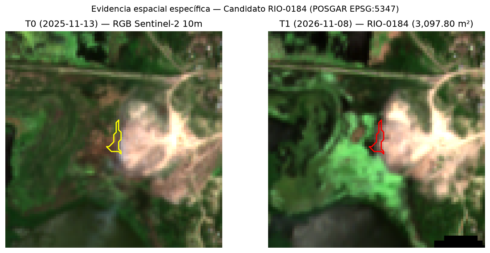
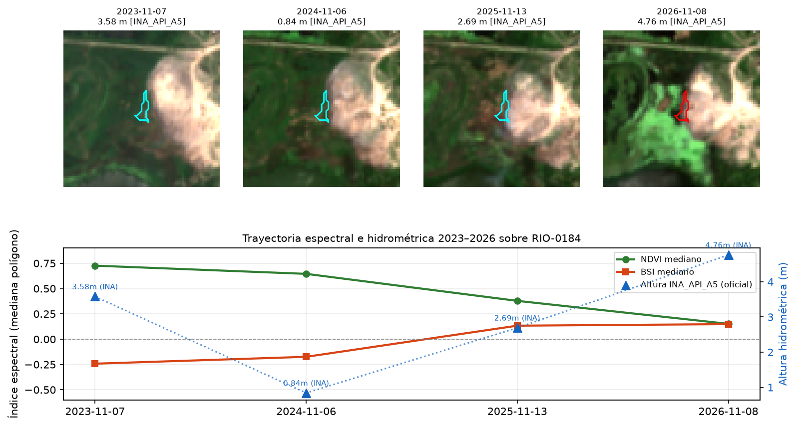

# Dossier de Investigación Territorial — RIO-0184

> **Regla epistémica obligatoria:** Este documento es una herramienta de orientación investigativa y fiscalización ambiental. Ninguna medición satelital por sí sola demuestra extracción de áridos ni infracción legal.

## 1. Ficha de identificación

| Campo | Valor |
| :--- | :--- |
| **ID de candidato** | `RIO-0184` |
| **Sector / AOI** | Paraná Medio — Sector Isla/Ribera Santa Fe–Paraná (RIO-0184 Exp 001) |
| **Período analizado** | 2023-11-07 .. 2025-11-13 (T0) -> 2026-11-08 (T1) |
| **Tipología morfológica** | `desmonte_ribera_acopio` |
| **Unidad geomorfológica estimada (heurística satelital T0)** | `PLANICIE_INUNDABLE_E_ISLAS` *(no equivale a cartografía geomorfológica oficial)* |
| **Centroide WGS84 (lon, lat)** | `-60.56343, -31.728375` |
| **Centroide POSGAR 2007 (EPSG:5347)** | `5446603.11, 6490094.78` |
| **Superficie vectorial exacta** | **3,097.80 m²** (0.3098 ha) |
| **Distancia al cuerpo de agua T0** | Sin dato |
| **Estado de verificación** | `PENDIENTE_VERIFICACION_TERRENO_Y_CATASTRO` |
| **Fecha de emisión** | 2026-11-15 17:11 UTC |

## 2. Resumen ejecutivo

- **Observación:** En el polígono `RIO-0184` (3,097.80 m², `PLANICIE_INUNDABLE_E_ISLAS`), las escenas Sentinel-2 registran un cambio espectral compatible con `desmonte_ribera_acopio` (diferencia media de píxeles: `ΔBSI_adj=0.4068`, `ΔNDVI_adj=-0.4265`, `ΔMNDWI=0.0349`).
- **Interpretación:** El patrón espectral sugiere pérdida de cobertura vegetal y exposición de superficie mineral o inundación localizada; no obstante, coexisten explicaciones alternativas (obra rural/portuaria, variación hidrométrica o artefactos de borde SWIR 20 m / SCL=7).
- **Hipótesis:** Compatible con posible movimiento de suelos, acopio o frente de extracción ribereña, así como con usos antrópicos autorizados o dinámica de borde aluvial.
- **Verificación:** Requiere inspección visual de alta resolución / drone, constatación en terreno y consulta de permisos ante la autoridad provincial competente.

## 3. Evidencia territorial y mapas

### Observación morfológica y espacial
- **Área geométrica (`shapely_polygon_posgar_2007`):** 3,097.80 m² (0.3098 ha).
- **Muestreo en grilla:** 29 píxeles a 10 m (~7.25 píxeles nativos SWIR de 20 m).
- **Morfología:** Rectangularidad `0.369`, elongación `2.333`.
- **Contexto geomorfológico estimado (heurística satelital T0):** `PLANICIE_INUNDABLE_E_ISLAS`, distancia al agua T0 `Sin dato`.
- **Productos cartográficos y figuras asociadas:**
  - `mapa_candidato_RIO-0184.png`
  - `figura_2_serie_temporal_RIO-0184.png`
  - `data/experiments/exp_001_parana_medio/06_anomalias_detectadas.geojson`

### Figura 1 — Comparación RGB Sentinel-2 (10 m) entre T0 (2025-11-13) y T1 (2026-11-08) con contorno vectorial POSGAR de RIO-0184 (3,097.80 m²).

*Figura 1. Comparación RGB Sentinel-2 (10 m) entre T0 (2025-11-13) y T1 (2026-11-08) con contorno vectorial POSGAR de RIO-0184 (3,097.80 m²).*
### Figura 2 — Serie visual RGB 2023–2026 sobre RIO-0184 y evolución conjunta de NDVI mediano, BSI mediano y altura hidrométrica INA (Puerto Paraná).

*Figura 2. Serie visual RGB 2023–2026 sobre RIO-0184 y evolución conjunta de NDVI mediano, BSI mediano y altura hidrométrica INA (Puerto Paraná).*

## 4. Evolución multitemporal

> **Nota metodológica:** Se distinguen explícitamente las **medianas espectrales por fecha** calculadas sobre el polígono de las **medias de diferencias por píxel (`delta_*_mean`)** ajustadas fenológicamente entre T0 y T1.

| Fecha | Escena / Sensor | Altura río (m) | Procedencia hidrométrica | B11 med. (DN) | NDVI med. | BSI med. | MNDWI med. | Clases SCL |
| :--- | :--- | :---: | :--- | :---: | :---: | :---: | :---: | :--- |
| 2023-11-07 | S2B_20HQK_20231107_0_L2A | 3.58 m | `INA_API_A5` | 2039 | +0.726 | -0.242 | -0.435 | 4:29 |
| 2024-11-06 | S2A_20HQK_20241106_0_L2A | 0.84 m | `INA_API_A5` | 1846 | +0.646 | -0.174 | -0.411 | 4:29 |
| 2025-11-13 | S2A_20HQK_20251113_1_L2A | 2.69 m | `INA_API_A5` | 2312 | +0.379 | +0.133 | -0.505 | 4:9, 5:20 |
| 2026-11-08 | S2A_20HQK_20261108_1_L2A | 4.76 m | `INA_API_A5` | 1573 | +0.151 | +0.149 | -0.363 | 4:3, 5:16, 7:10 |

**Criterio de procedencia hidrométrica:** `INA_API_A5` (observación oficial consultada en tiempo de ejecución), `FALLBACK_EXP001` (valor histórico heredado de Exp 001 usado solo si falla la API; no es observación nueva), `FALLBACK_MANUAL` (respaldo manual) y `NO_DISPONIBLE` (sin dato).

**Resumen de diferencias por píxel (T0 -> T1):** `delta_bsi_mean=0.4068`, `delta_ndvi_mean=-0.4265`, `delta_mndwi_mean=0.0349`.

## 5. Análisis de hipótesis alternativas

| Hipótesis | Nivel | Evidencia observada compatible | Evidencia en contra / incertidumbre | Estado |
| :--- | :--- | :--- | :--- | :--- |
| **H1. Extracción / acopio de áridos o desmonte operativo** | Hipótesis | Cambio localizado `desmonte_ribera_acopio` de 3,098 m² en `PLANICIE_INUNDABLE_E_ISLAS`, `ΔBSI_adj=0.407`. | Resolución SWIR 20 m insuficiente para distinguir acopio mineral de obra civil sin VHR/campo. | `A VERIFICAR EN TERRENO` |
| **H2. Obra civil, camino rural o infraestructura ribereña** | Hipótesis | Incremento de suelo expuesto (`B11_T1=1574 DN`) y geometría con elongación `2.33`. | No se dispone de catastro parcelario ni permisos de obra cargados en el sistema. | `NO DESCARTABLE` |
| **H3. Dinámica fluvial / humedad edáfica / crecida** | Interpretación | Contexto hidrométrico: Δagua AOI=25.15%, Δaltura=+2.07 m (2.69 m [`INA_API_A5`] -> 4.76 m [`INA_API_A5`]). | El polígono superó filtros de cinturón de crecida, migración dipolar y agua oscura (`B11_T1=1574`). | `RESIDUAL TRAS FILTROS` |
| **H4. Artefacto atmosférico / sombra / borde SCL=7** | Interpretación | Píxeles `SCL=7` en T1: 10; adyacencia nube/sombra: `False`. | Fracción de píxeles válidos `1.0`. | ATENCIÓN: PRESENCIA SCL=7 |

## 6. Confiabilidad por dimensión

> **Score numérico interno:** `0.593` (escala 0–1). Este índice resume fuerza de señal, compacidad geométrica y penalizaciones por confundidores; **no** se traduce automáticamente a una categoría cualitativa de certeza ni sustituye la evaluación pericial.

| Dimensión | Medición / Estado |
| :--- | :--- |
| **Calidad espectral y máscara SCL** | Fracción válida: `1.0`, adyacencia nube/sombra: `False`, SCL=7: `10` px |
| **Resolución espacial efectiva** | 20.009770821454982 m SWIR (~7.25 píxeles SWIR en el polígono) |
| **Estabilidad hidrométrica del tramo** | Variación lámina AOI: `26.29%`; score de confundidores naturales: `0.25` |
| **Persistencia temporal de línea base** | `1` escena(s) en T0 |

## 7. Limitaciones y datos faltantes

- Resolución física limitante 20 m (bandas SWIR B11/B12 a 20 m nativos).
- Variación hidrométrica regional detectada en el tramo (+26.3%).
- Evaluación basada en única escena histórica T0 (sin serie multitemporal extensa).
- En Exp001 recalibrado (Fase 2.1), el núcleo de este mismo sitio sobrevive como RIO-0013 (1,848.69 m²) tras excluir píxeles de borde con SCL=7.
- Procedencia hidrométrica por fecha: 2023-11-07:INA_API_A5; 2024-11-06:INA_API_A5; 2025-11-13:INA_API_A5; 2026-11-08:INA_API_A5.
- Cruce administrativo/catastral: Sin cruce realizado contra catastro oficial provincial o registro de concesiones mineras/áridos.
- Superficie cercana al límite operativo SWIR 20 m (3,097.8 m² ≈ 7.25 px SWIR): susceptible a efecto de píxel mixto en bordes.

## 8. Recomendación de actuación (Nivel: Verificación)

1. **Inspector ambiental:** Verificar en terreno las coordenadas WGS84 indicadas para constatar presencia de dragado, refulado, acopio o movimiento de suelos, o descartar uso rural/obra ajena a áridos.
2. **Autoridad provincial / Catastro y Minería:** Cruzar el polígono contra padrón catastral, concesiones mineras de 3ª categoría y permisos ambientales vigentes.
3. **Prefectura / Control ribereño:** Utilizar el centroide como orientación geográfica preliminar en patrullajes de jurisdicción fluvial, sin asumir infracción previa.
4. **Seguimiento satelital:** Incorporar imagen VHR o vuelo UAV si se requiere precisar volúmenes o límites parcelarios por debajo de 20 m.

## 9. Fuentes, parámetros y trazabilidad técnica

- **CRS métrico de cálculo:** `EPSG:5347` (POSGAR 2007). Exportación GeoJSON: `EPSG:4326`.
- **Procedencia hidrométrica (Puerto Paraná (INA seriesId=30), unidad `m`, consulta=2026-11-15 17:11 UTC):** T0=`2.69` m (`INA_API_A5`), T1=`4.76` m (`INA_API_A5`).
- **Resolución de grilla / SWIR nativo:** 9.996810442680092 m / 20.009770821454982 m (reconstrucción de huella de píxel completo mediante buffer cuadrado `5.0` m).
- **Áreas mínimas de detección:** 1600.0 m² (excavación inundada / frente extractivo) y 800.0 m² (desmonte ribereño / acopio).
- **Parámetros congelados Fase 2.1 (42):** `min_anomaly_area_m2=1600.0`, `min_clearing_area_m2=800.0`, `bsi_reg_albedo_k=800.0`, `dark_water_min_b11_dn=600.0`, `dark_water_min_b04_dn=420.0`, `dark_water_min_b08_dn=350.0`, `dark_water_min_b11_b03_ratio=0.85`, `scl7_min_b11_dn=850.0`, `scl7_min_b04_dn=500.0`, `hydrometric_stage_rise_alert_m=0.8`, `moderate_stage_rise_m=0.4`, `water_stage_warning_pct=8.0`, `reach_water_mndwi_threshold=0.15`, `systemic_stage_strong_pct=12.0`, `shoreline_change_min_fraction=0.25`, `flooded_min_delta_mndwi=0.4`, `flooded_min_t1_mndwi=0.2`, `clearing_min_delta_bsi_adj=0.25`, `clearing_min_delta_bsi_reg=0.18`, `clearing_min_t1_bsi_reg=0.03`, `clearing_max_delta_ndvi_adj=-0.3`, `clearing_min_t1_bsi=-0.02`, `clearing_max_t1_mndwi=0.1`, `road_min_elongation=4.0`, `cloud_shadow_buffer_m=40.0`, `turbidity_open_water_mndwi=0.2`, `turbidity_wet_bar_mndwi=0.05`, `turbidity_red_shift_dn=150.0`, `turbidity_bright_bar_b04_dn=750.0`, `geomorph_water_mndwi_min=0.05`, `geomorph_min_channel_area_m2=50000.0`, `geomorph_bar_max_ndvi=0.25`, `geomorph_bar_max_dist_m=300.0`, `geomorph_lagoon_buffer_m=450.0`, `geomorph_island_max_dist_m=2500.0`, `dipole_min_abs_delta_mndwi=0.35`, `dipole_max_erosion_ndvi=0.35`, `dipole_min_accretion_mndwi_t0=0.05`, `dipole_min_area_ratio=0.4`, `dipole_max_area_ratio=2.5`, `dipole_max_span_m=450.0`, `riparian_veg_min_ndvi_t0=0.45`.
- **Nota institucional del motor:** Las geometrías detectadas son anomalías morfológicas candidatas; no constituyen por sí solas infracción ni extracción ilegal sin cruce catastral oficial y revisión humana.
